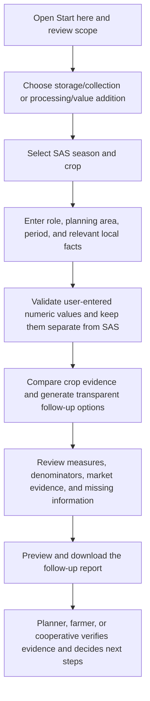

# AgriLoss Rwanda user workflow

AgriLoss supports first-pass planning for post-harvest collection/storage and agricultural processing/value addition. The public dashboard reads grouped SAS 2024 summaries. It does not load farmer or plot records.

## Eight steps in the dashboard

1. **Open the system.** Farmers/producers, cooperative staff, agricultural planners, researchers, and other project partners can use the public prototype. The Start here tab introduces the SAS scope and current release status.
2. **Select an agricultural challenge.** In Crop workspace, choose post-harvest collection/storage or processing/value addition.
3. **Enter the planning case.** Select a crop and a SAS survey season (A, B, C, or all published seasons), choose your user role, enter a district/cooperative/market area and planning period, and select relevant local conditions. The optional province summary is separate context. Depending on the track, add expected supply and storage capacity or processing capacity, a current buyer quote, and an estimated variable processing cost.
4. **Validate and prepare data.** The release builder creates unweighted season, crop, and season-by-crop summaries from NISR production extracts. Groups below 100 records are pooled within season. Blank survey answers remain missing; negative stage-loss entries remain visible quality flags. Numeric planning inputs accept non-negative values and remain user-supplied; they are never joined to survey records.
5. **Review decision support.** Storage recommendations use positive storage/transport response shares and show the count, valid denominator, and relative named-crop quartile. Processing options use food/drink/other transformation evidence, sales responses, and historical prices where available. Local conditions create matching field checks. Missing local evidence is listed for verification.
6. **Compare results.** The selected crop's storage, transport, transformation, and sales measures are shown with valid denominators. A crop-by-season chart supports seasonal comparison. Season C is restricted. Market channel prices are SAS Season A 2024 reports and are historical. The current SAS release contains no verified costs; AgriLoss does not calculate costs, margins, or profitability.
7. **Generate a report.** Review the recommendation, preview the Markdown report, and download the selected crop/season evidence, planning inputs, local conditions, suggested actions, checks, and limitations.
8. **Make an informed next-step decision.** Use the report to plan field checks, engage farmers/cooperatives/processors/buyers, and decide whether further analysis or a pilot is warranted. Confirm supply, facility/route conditions, current buyer terms, product quality, yields, and costs before any investment decision.

## What the location and numeric inputs mean

The typed planning area, period, role, quantities, buyer quote, and processing-cost estimate are context supplied by the user. They do not filter SAS survey records. Province values are an independent sample summary and are not a crop-by-province result. The app does not calculate crop-location loss estimates or validated economic margins.

The optional processing cost and current quote are shown in the report as user inputs. SAS 2024 does not provide operating-cost data, and the tool does not treat these values as validated or use them to estimate profitability. A zero in a numeric input means “not supplied.”

The current workflow supports transparent investigation and planning. It does not automatically choose an intervention or claim improvements in farmer outcomes.
